# TUSCANINI — PHOTOGRAPHY SOURCE AUDIT / CREATIVE BRIEF 03
Date: 2026-11-01 · **Source photo audit by direct visual inspection**
Source module: `lib/rebirth/food-media.ts` · Original 640×640 files, historically supplied from the restaurant Facebook page. Actual merchant ownership/usage authorization and exact SKU associations still need final signoff.

**Design goal:** food is a genuine physical fact, not filler. First food choices remain immediately available; original images appear as *one editorial interruption after six actual products*, never as a named dish illustration.

## Twelve original photographs — contact sheet and use policy

| Source | Photograph | What is actually shown | Appropriate visual role | Decision |
|---|---|---|---|---|
| TSC-01 | 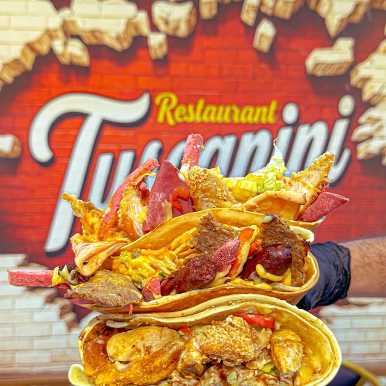 | Multiple open crepes in front of restaurant sign | Brand/location context | Hold for identity story; busy background |
| TSC-02 | 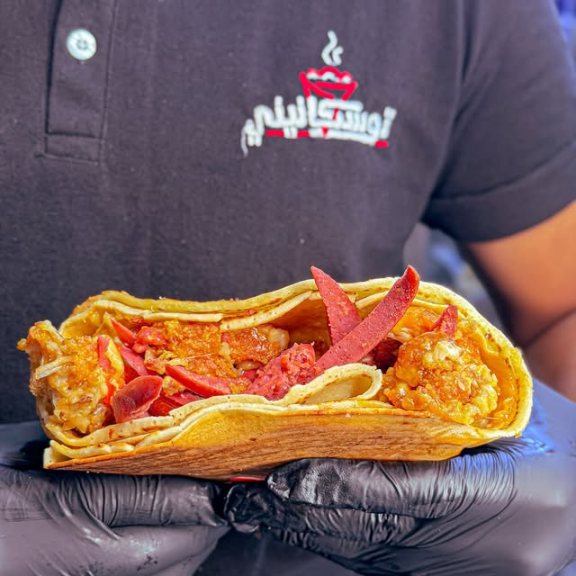 | One opened crepe supported by a gloved employee | Crepe family photographic break | **Use** under Crepe; no ingredient promise |
| TSC-03 | 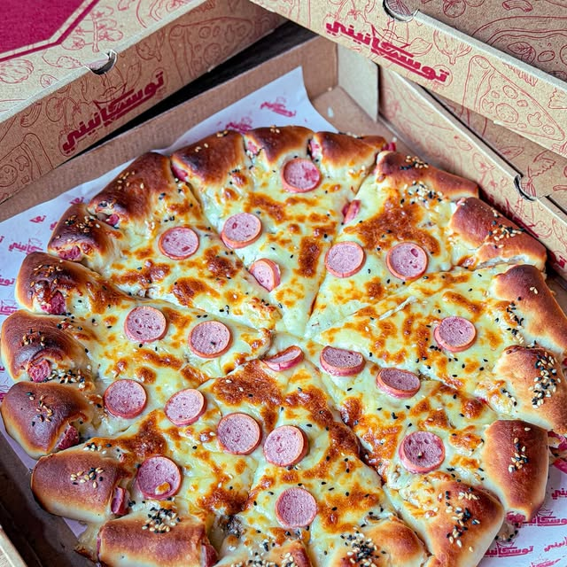 | Pizza in a printed Tuscanini box | Pizza/packaging context | Hold as alternative to TSC-10; good packaging evidence |
| TSC-04 | 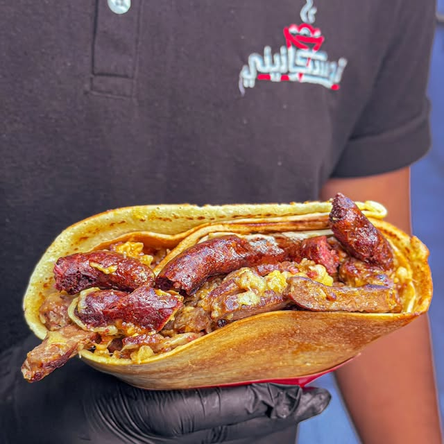 | Single crepe cross-section held by staff | Crepe texture/detail | Hold; overlaps with TSC-02 |
| TSC-05 | 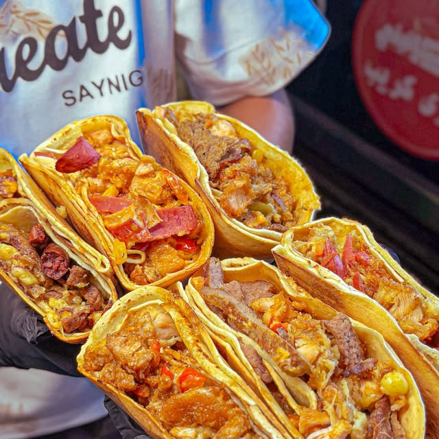 | Group of mixed open crepes with visible background signage and clothing | Variety/story | Do not use as item photo; cluttered context |
| TSC-06 | 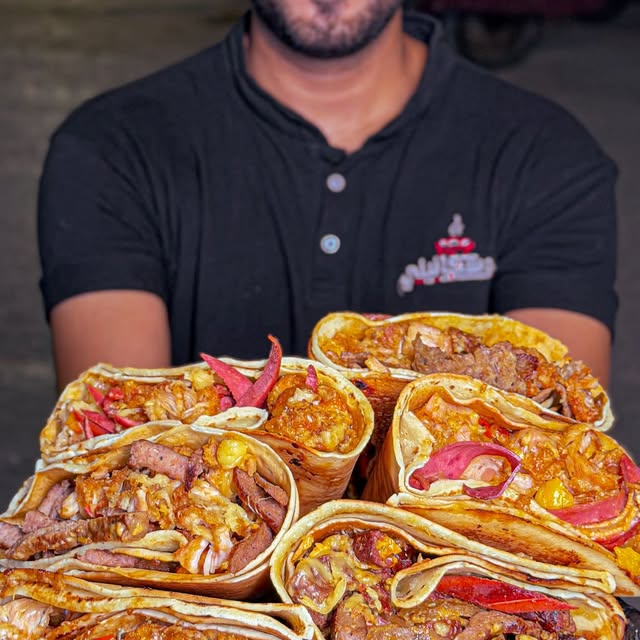 | Staff presenting several open crepes, face partially visible | Human scale and abundance | Hold for story, not a menu SKU |
| TSC-07 | 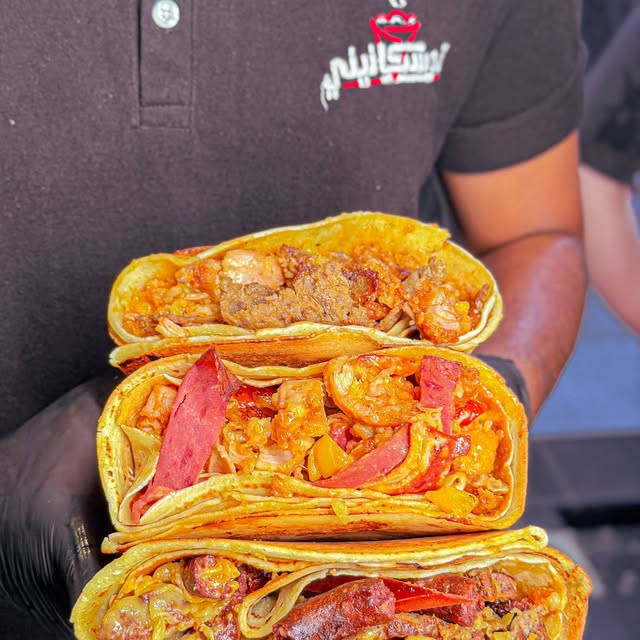 | Three stacked opened crepes, staff shirt behind | General menu documentary cutaway | **Use** under All after sixth item |
| TSC-08 | 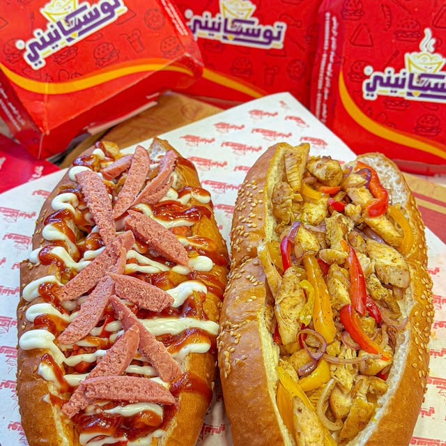 | Two dressed sandwiches in front of red branded packages | Sandwich family/brand context | **Use** under Sandwiches |
| TSC-09 | 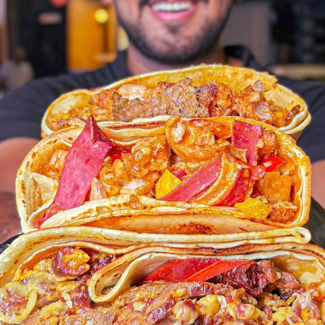 | Very close open-crepe trio, cropped staff face | Macro food close-up | Hold; near-repeat of 07 |
| TSC-10 | 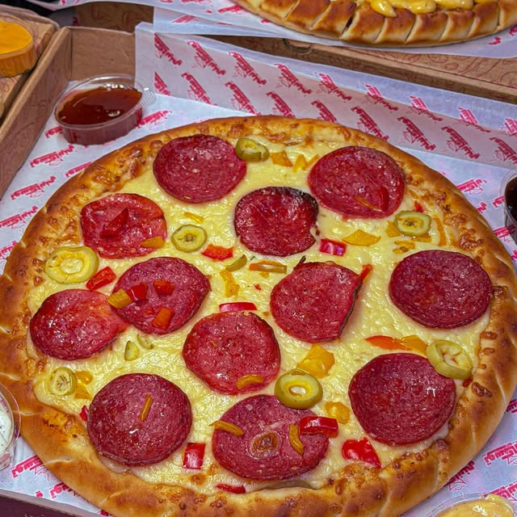 | Whole pizza photographed from above | Pizza family | **Use** under Pizza |
| TSC-11 | 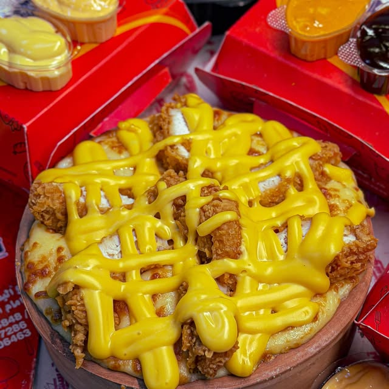 | Heavily sauced dish, red packs around | Packaging/sauce editorial story only | Hold until dish identity verified |
| TSC-12 | 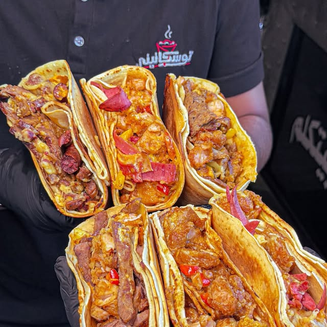 | Staff holding multiple opened crepes | Variety/scale | Hold for brand context; redundant in menu |

**Never:** map these to `item.id`, advertise a particular filling or portion, or convert a family photo into proof of a named dish. All historic menu prices/availability remain pending merchant signoff. A generic restaurant image belongs to the **category**, not the individual SKU.

## Creative selection logic shipped in this draft branch
- `All`: TSC-07 · *الكريب من جوّه.* (the first 6 historical entries happen to be crepe items).
- `Crepe`: TSC-02 · *الكريب من جوّه.*
- `Pizza`: TSC-10 · *البيتزا.*
- `Sandwiches`: TSC-08 · *الساندوتشات.*
- `Pasta / Sweets / Sides / Drinks`: **no authentic verified category photo**, so no editorial break.
- Typed search: **zero photo breaks**.
- Short category result sets: **zero photo breaks** (minimum nine results).
- Underlying historical menu/listing, order state and product images are unchanged. Category photography is always accompanied by a visible source/identity disclaimer.

## First real-site experiment
`getMenuEditorialPhotograph(family)` chooses only documented sources from the manifest. `MenuEditorialPhoto` is inserted after the sixth `RebirthMenu` food row. It lives inside the existing `/` and `/menu` Next.js interface and shares the current catalog, product dialog and cart.

Layout: a wide dark-ink editorial break, 1 large real food photograph, short Arabic headline, tiny truthful caption. No duplicated CTA, no giant Hero or motion gimmick. Mobile layout is capped in height to avoid displacing subsequent food.

## Research context, not evidence of Tuscanini conversion
- Baymard Food Delivery UX overview: food choice, item comparison, sizing, customization, pickup/delivery journey, https://baymard.com/industries/food-delivery-and-takeout-ux
- Uber Eats genuine photo guidance: show actual meal and visible food, natural light/cross sections, https://help.uber.com/ubereats/restaurants/article/user-submitted-photo-guidelines?nodeId=51a59be6-280f-48f8-af68-4c076c6b3dba
- Otter menu photo guide: restaurant's own accurate dishes and correct scale, https://helpdesk.tryotter.com/hc/en-us/articles/4409825355155-Menu-Photo-Guide
- Visual editorial references (inspiration **only**, never proof of UX outcomes): Isometric Studio's Lulla menu and the Art of the Menu archive on UnderConsideration.

## Future shoot with merchant
One consistent real-shoot setup: counter/tabletop as restaurant, diffuse directional daylight, true portion size, 3/4 or top angle as appropriate, visible crepe filling cross section, no invented ingredients, 4k originals with square/landscape/mobile crops. Photograph every active SKU *only after* merchant confirms dish names, sizes and serving standards.

## Acceptance gate
- Real page: first food item before first 390px fold, no overflow, prices/notes intact.
- Exactly one TSC-07 contextual image after six real food items on All; TSC-10 on Pizza; TSC-08 on Sandwiches; none during search.
- The original image resolves/decodes in Chromium at mobile and desktop widths.
- Product dialog, cart path and no-order-POST guard remain intact.
- Manual review of 390 and 1440 screenshots and actual device test before merging. CI passing is necessary but not final art approval.

**Draft only: no `main` merge, production release, backend write or ordering flag change.**
